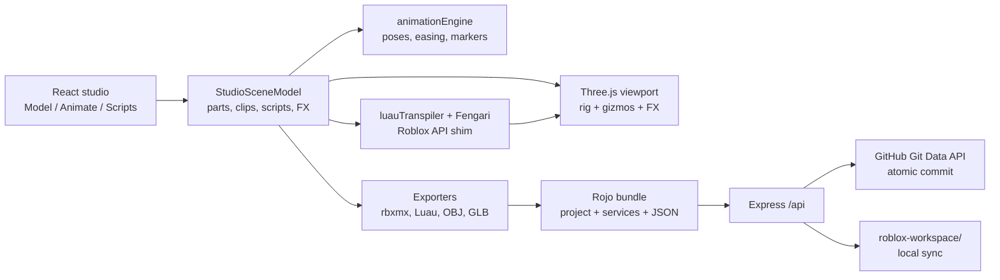
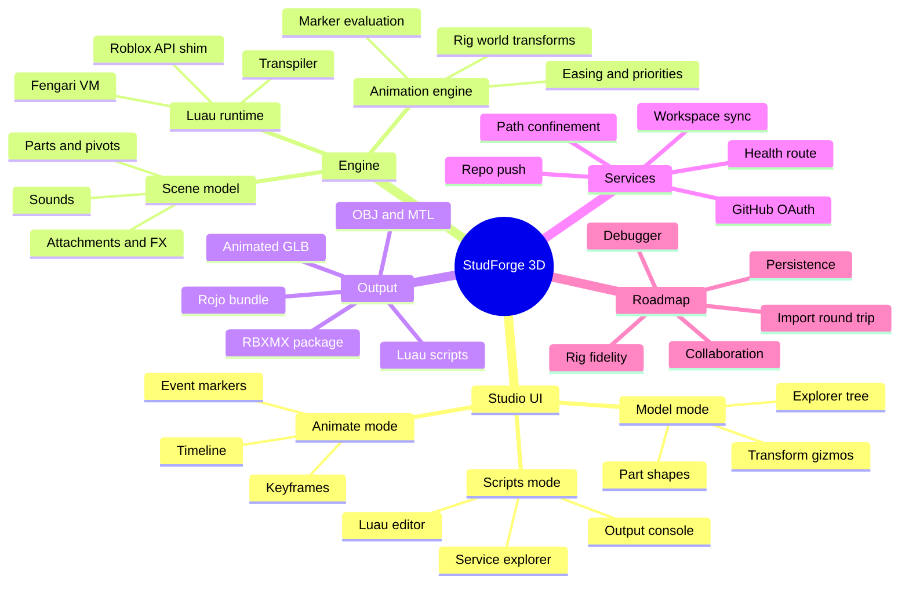

# StudForge 3D

Browser-based studio for prototyping rigged Roblox-style models: build blocky parts, animate Motor6D hierarchies, run Luau scripts against a live 3D preview, and publish a Studio-ready package or a Rojo project to GitHub.

> Private, early-stage project exported from Google AI Studio (app `463f0314-79bf-4b7d-8819-37a8dcb6b44d`). Not affiliated with Roblox Corporation.

## Features

|Area|What works today|
|---|---|
|**Model**|10 Roblox-like shapes (Block, Cylinder, Ball, Wedge, CornerWedge, HexPrism, BevelPlate, PipeElbow, Archway, LatheCone), 11 materials, stud grid + R15 avatar reference, select/move/rotate/scale gizmos, part tree with reparenting that preserves world transforms, cycle-safe rigging, Motor6D pivot offsets, validation report.|
|**Animate**|Multi-clip timeline with keyframes at 30 fps default, Roblox `EasingStyle`/`EasingDirection`/priority, auto-key, resampling, event markers that drive FX (emit/enable/disable/pulse), live playback, first-class attachment/effect/sound previews in the viewport.|
|**Scripts**|Roblox service explorer (`Workspace/<Model>`, `ReplicatedStorage`, `ServerScriptService`, `StarterPlayerScripts`, `StarterCharacterScripts`), `Script`/`LocalScript`/`ModuleScript`/`RemoteEvent`/`BindableEvent`/Value objects, Luau templates, editor, live Luau execution in a sandboxed Fengari VM wired to the 3D rig and an output console.|
|**FX & audio**|Attachments, `ParticleEmitter`, `Trail`, `PointLight`, and `Sound` nodes with `rbxassetid://` IDs; burst/pulse/light overrides from scripts at runtime.|
|**Export**|`.rbxmx`, generated Luau scripts (create-rig, single-stage animation, multi-stage controller), five framework modules, `.obj` + `.mtl`, animated binary `.glb`, Rojo-compatible bundles, `.studforge.json` project snapshots.|
|**Publish**|Push bundles to a GitHub repo with PAT or OAuth using a single Git Data API commit, or sync files into a confined local `roblox-workspace/` folder.|

Five rigged presets ship with the app: Jade Blocky Dragon, Orbital Relay Beacon, Aegis Defense Turret, Stone & Timber Outpost, and Hover Interceptor.

## Quick start

Requirements: Node.js 22+ (or Bun) and a modern browser with WebGL.

```bash
bun install
bun run dev            # Express + Vite middleware at http://localhost:3000
```

The repo includes `bun.lock`; Bun is the intended package manager. With npm, strict peer resolution fails because `vite@8` wants esbuild `^0.27 || ^0.28` while `tsx` pins `0.25.x`. Use:

```bash
npm install --legacy-peer-deps --no-package-lock
npm run dev
```

`npm run build` produces `dist/`; `NODE_ENV=production npm start` serves that build from Express. `PORT` overrides port 3000. Optional environment variables go in `.env.local`:

|Variable|Purpose|
|---|---|
|`PORT`|HTTP listen port (default `3000`).|
|`GITHUB_CLIENT_ID`, `GITHUB_CLIENT_SECRET`|Required only for in-app GitHub OAuth. PAT push and local workspace sync work without them. The OAuth callback is `<origin>/auth/callback`.|
|`GEMINI_API_KEY`, `APP_URL`|AI Studio runtime template variables. No active server route currently consumes them.|

## How it works



`StudioSceneModel` (`src/engine/robloxTypes.ts`) is the single source of truth. The viewport reads evaluated poses from `animationEngine`, the script runner reads a model snapshot and writes back runtime pose/FX/attribute overrides, and exporters serialize the same model. The server is a thin Express layer: it proxies GitHub and writes local sync files; the studio itself runs entirely in the browser.

### Luau sandbox

`luauTranspiler.ts` normalizes common Luau extensions (type declarations, `::`/`:` annotations, compound assignments, inline `if` expressions, `continue`, backtick strings) to Lua 5.3 before `fengari` executes them. The shim provides a subset of Roblox APIs — `Vector3`, `CFrame`, `Color3`, sequences, service/Instance trees, `Motor6D`, events, `task`, `RunService`, `TweenService`, `print`/`warn`/`error` — and maps their effects back to the 3D preview and console. `os`/`io`/`dofile` are removed and a per-run instruction budget guards against infinite loops. It is a local simulation, not the Roblox engine.

### Export formats

|Output|Producer|Use|
|---|---|---|
|`.rbxmx`|`generateRbxmx`|Model package with Parts, Motor6D, Attachments, effects, sounds, KeyframeSequences, and service scripts|
|`.luau`|`generateLuauScript`, `generateLuauAnimationScript`, `generateLuauMultiStageScript`|Command-bar rig builder, animation players, multi-stage `playStage()` controller|
|`.obj` + `.mtl`|`generateObjAndMtl`|MeshPart / 3D Importer workflow|
|`.glb`|`exportModelToGlb`|Binary glTF 2.0 with hierarchy and animation clips|
|Rojo bundle|`generateRojoProjectBundle`|`default.project.json`, service script tree, `.rbxmx`, meshes, `.studforge.json`|

`validateModelForRoblox` reports duplicate names, broken Trails, rig anchors, triangle limits, and appearance channels before export. The export modal offers Studs or Meters scale (1 stud ≈ 0.28 m).

### Security notes

- PATs and OAuth session tokens stay in React memory, never `localStorage`; OAuth state and sessions expire after 10 minutes and 6 hours respectively.
- Local sync writes only under `roblox-workspace/<sanitized model name>`; absolute paths, drive prefixes, and `..` segments are rejected by `src/server/workspaceConfinement.ts`.
- GitHub pushes validate `owner/repo` and branch names and cap bundles at 200 files. Keep tokens in environment variables; `.env*` is gitignored.

## Project layout

```
src/
  App.tsx                    top-level studio state and UI orchestration
  components/                viewport, explorer, inspector, timeline, script workshop, export/sync modals
  engine/
    robloxTypes.ts           scene schema, materials, shapes, validation types
    animationEngine.ts       pose evaluation, easing, rig solving, keyframes/markers
    robloxExporter.ts        .rbxmx, Luau, OBJ+MTL generation, validation
    glbExporter.ts           animated glTF 2.0 export
    rojoPackager.ts          Rojo/GitHub/workspace bundles
    luauTranspiler.ts        Luau → Lua 5.3 normalizer
    robloxSandbox.ts         Fengari VM + Roblox API shim
    robloxScriptFramework.ts generated ModelRuntime/RigAnimator/FXController/SoundController/StageConfig
    presets.ts, dragonPreset.ts, scriptPresets.ts
  server/workspaceConfinement.ts
server.ts                    Express API + Vite middleware
.aistudio/                   original AI Studio design plan and reference media
```

## Roadmap

Ordered by what unblocks the next iteration; items are planned, not implemented.

### 1. Persistence and round-trip

- [ ] Autosave and explicit project open/save in the browser — today the scene lives in React state and resets on reload.
- [ ] Import `.studforge.json` snapshots as well as `.rbxmx`/`.luau`; currently the app only exports these.
- [ ] Diff-friendly project serialization so Rojo sync and GitHub commits stay reviewable.

### 2. Animation and rig fidelity

- [ ] Export appearance channels (Size/Color/Transparency) into `.rbxanim`/`KeyframeSequence` assets, not just generated Luau tweens.
- [ ] R6/R15 humanoid presets and advanced constraints (Weld, BallSocket, HingeConstraint) alongside Motor6D rigs.
- [ ] Visual curve editor, easing previews, and marker-to-sound auditioning in the timeline.

### 3. Scripting and testing

- [ ] Broader Roblox shim coverage (`Instance` attributes, `HttpService`, `DataStoreService` stubs), with source-mapped line numbers in runtime errors.
- [ ] Breakpoints/step-through in the Luau editor and script-to-part spotlighting from console entries.
- [ ] Wire the 35 existing `node:test` engine tests into an `npm test` script and CI.

### 4. Publishing and collaboration

- [ ] Rojo live-sync connection and automatic project reload after a GitHub push.
- [ ] GitHub Actions pipeline for build, typecheck, tests, and release artifacts.
- [ ] Shareable scenes / multi-user review with server-side project storage and access control.

### 5. Modeling

- [ ] Mesh import (`.glb`/`.obj`) and boolean operations for custom parts.
- [ ] `SurfaceAppearance`/texture support and material parity with current Roblox Studio.
- [ ] Touch-optimized transform controls for mobile browsers.

## Mindmap



## Tests

The engine has 35 `node:test` cases across `animationEngine.test.ts`, `luauSandbox.test.ts`, and `robloxExporter.test.ts`:

```bash
npx tsx --test src/engine/*.test.ts
```

## Credits

Built with React, Three.js, Vite, Express, Tailwind CSS, and Fengari. Exported from Google AI Studio; the original design plan is kept under `.aistudio/artifacts/brain/`. No license has been added yet — this repository is private.
